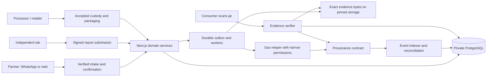

# Target use case and technical architecture

All designs in this file are proposals. The current implementation and its defects are documented in [the audit](01-APPLICATION-AUDIT.md).

## 1. A focused use case

**Pollinator: affordable honey provenance and recall for beekeeper cooperatives.**

A cooperative records harvests for its members, a laboratory issues identifiable batch-linked evidence, a processor accounts for the honey it packages, and retailers/consumers check a jar's provenance and current recall status. Farmers use familiar WhatsApp text or voice; the system does not require each farmer to buy crypto or manage gas.

The primary customer hypothesis is a beekeeper cooperative, farmer producer organisation, or small honey processor that needs auditable provenance and recall coordination. Farmers and consumers are beneficiaries. The pilot must establish whether the organisation will operate the workflow and pay for it; neither willingness to pay nor improved farmer income has been validated.

### The problem to validate

- Can the cooperative reconcile a retail jar with a harvest lot, actual custodian, and relevant lab sample today?
- How long does a quality complaint take to trace and recall across partner organisations?
- Which records are disputed, missing, or costly to maintain?
- Is the real adoption barrier record entry, laboratory cost, label handling, connectivity, or buyer incentives?

Interview stakeholders before presenting a general honey-adulteration problem as evidence for this particular product. Blockchain does not detect adulteration; reliable sampling/testing and honest physical custody remain necessary.

### A minimum complete product

1. Verified beekeeper/cooperative enrollment and one assisted harvest workflow in Hindi and English.
2. One batch registration with a confirmed public testnet commitment and retrievable evidence.
3. An enrolled laboratory signs a sample-linked report; failed/inconclusive reports cannot authorize packaging.
4. The current processor accepts custody and packages within the remaining mass allowance.
5. Exactly the committed jar serials receive labels. The consumer sees evidence status, source, and date of the latest check.
6. The authorised recall actor flags a batch; all affected jars display a warning, including when chain submission is pending.

Keep Varroa advice and telemetry as an optional farmer-support workflow. They do not prove the honey's composition. Defer marketplace payments, speculative tokens, NFTs, DAO voting, carbon credits, automated subsidy decisions, multi-chain deployment, and custom zero-knowledge work until there is a demonstrated need.

## 2. Why a blockchain can be useful

The relevant coordination problem is disagreement between independent organisations. A cooperative, laboratory, processor, and buyer should be able to verify who authorized an event and whether evidence changed after a dispute.

A conventional database remains the right system for queries, personal data, media, telemetry, and business operations. A signed append-only database may be enough if all participants accept a single administrator. Use a public-chain commitment when independent parties actually need a shared verification boundary; document the extra cost and complexity.

Three honest deployment options:

- **Platform-attested MVP:** the platform submits records and explicitly takes responsibility for them. Low friction, but central trust remains. Do not claim each actor signed.
- **Recommended independent-attestation design:** organisations retain or control their signing authority; a limited relayer pays gas. An organisation cannot create another organisation's valid signature.
- **Database-only pilot control:** retain signed records without anchoring for a small comparison group. Measure whether anchoring changes auditability, dispute handling, cost, or adoption enough to justify it.

Start with one EVM testnet already supported by the repository. Amoy is a test environment, not production certification. Do not redeploy merely to add an NFT standard: a batch registry with clear invariants is sufficient.

## 3. Proposed system

This diagram is a target, not a description of an existing queue/indexer implementation. Keep domain operations in reusable server-side services; web APIs and WhatsApp should invoke the same service rather than forwarding broad admin credentials through a public URL.

### On-chain data

Store compact commitments and accountable transitions:

- Versioned batch identifier and issuing organisation/actor.
- Declared harvest quantity and relevant timestamp.
- Evidence hash and CID/reference digest with explicit algorithms.
- Current physical custody holder and accepted transfer events.
- Laboratory attestation ID/hash, signer, outcome, and revocation/supersession relationship.
- Packaging run ID, consumed mass, count/size or serial commitment.
- Recall flag, issuer, reason hash, affected scope, and event time.
- Operation replay protection and governance events.

### Off-chain public evidence

Use a deliberately published, redacted metadata document: batch ID, coarse origin, declared honey type, declared harvest date/mass, lab attestation summary and retrievable report reference, packaging totals, provenance events, recall summary, issuer, and schema version.

### Private data

Keep phone numbers, identity documents, detailed farm coordinates, commercial contracts, worker notes, raw images/audio, scan telemetry, raw IoT series, and secret material in access-controlled systems. Do not publish them to a public blockchain or publicly pinned IPFS. Removing a link later cannot reliably retract public copies.

## 4. Identity, signatures, and governance

### Farmers and cooperatives

Authenticate the WhatsApp sender through the validated Meta delivery and a canonical phone-to-user association. Use a short-lived signed challenge or OTP for web sign-in. A WhatsApp voice confirmation is a recorded user interaction, not an EVM signature.

For the first pilot, let an enrolled cooperative attest that it witnessed/recorded a farmer's confirmation. Store `subjectFarmerId`, `recordedByActorId`, `sourceChannel`, `confirmationReference`, and `attestationType=COOPERATIVE_ASSISTED`. Publish only consented public identifiers. If an independently controlled farmer signing mechanism is later introduced, label it separately.

### Laboratories and processors

Enroll organisation membership and verify the claimed lab identity/credential through an explicit human process. Keep a credential reference, reviewer, scope, expiry, and revocation status. Enrollment is not a blanket certification by Pollinator.

A lab signs a typed attestation that binds at least the batch, sample identity/seal, report hash, outcome, method/version, issuer, issue time, validity, operation nonce, and expiry of the transaction authorization. Processors sign packaging instructions and accept incoming custody.

Use EIP-712 domain separation with application name/version, chain ID, and verifying contract. Include operation kind, all meaningful arguments, per-signer nonce, deadline, and relevant expected state/version. Validate signature, signer role/membership, freshness, nonce, and state **inside the contract**. EIP-712 alone does not stop replay. Support contract wallets through appropriate signature validation if required; do not assume every signer is an EOA.

The relayer pays fees and submits signed messages. It must not be able to invent another actor's attestation. Protect its signing key and set fee/spending/throughput limits; keep governance separate.

### Governance

Separate actor enrollment, pausing, and recall authority. Use a multi-party admin arrangement or timelocked changes for production governance where practical; do not add complex governance to a time-limited demo without testing it. Emergency recall should remain available while routine writes are paused. Every privileged action needs an identifiable issuer and audit event.

## 5. Contract invariants

Keep business stage, lab approval, custody, evidence availability, and transaction state as separate dimensions. A single increasing number cannot model all of them correctly.

### Registration

- A batch ID is unique within the explicitly defined chain/contract/issuer scope.
- Initial declared mass is positive and within supported bounds.
- Harvest time is plausible under the chosen policy; backdated declarations are labeled as declarations.
- The originating actor/represented farmer relationship is explicit.

### Custody

- Propose a transfer to an enrolled eligible organisation; include expected current owner and operation version.
- Recipient accepts; until acceptance the sender remains custodian and the transfer is `OFFERED`.
- Cancellation/expiry/dispute do not silently rewrite historical custody.
- Lab approval and packaging cannot be created by choosing those names in a transfer dropdown.

### Laboratory evidence

- Only an active authorised lab can attest under its identity.
- An attestation binds the actual sampled batch and report bytes.
- Rejected, inconclusive, expired, revoked, or superseded evidence does not authorize new packaging.
- Corrections append a new attestation that references the previous one; historical records remain inspectable.
- A recall is independent of approval and overrides consumer availability for the affected batch/jars.

### Packaging and mass balance

Use integer grams and checked arithmetic with a sufficiently wide intermediate type. At every operation:

`packagedMass + recordedLoss + transferredOutMass <= declaredAvailableMass`

For a single 25,000 g lot with no loss, 50 jars × 500 g consumes all 25,000 g; any additional jar is rejected. With 1,000 g documented processing loss, only 48 jars × 500 g fit and no mass remains. Loss is separately recorded; it does not silently change the original harvest declaration.

Each packaging run is immutable and has a unique ID, quantity, serial range/commitment, actor, and evidence reference. Reprints retain the existing serial; replacement labels require an explicit revocation/replacement trail. Repackaging must consume/revoke previous stock so it cannot inflate available honey.

Batch splitting and mixing are later features. A future transformation event should reference input batches and consumed mass, output batch quantities, and loss. Descendant recalls must follow this graph. Do not claim such lineage exists in the current schema.

## 6. Exact evidence storage

1. Validate a versioned metadata schema and redact private fields before publishing.
2. Serialize recursively using one documented canonical JSON format, or use an explicit schema-specific encoder. Preserve the format version.
3. Produce one UTF-8 byte buffer and hash it with the documented algorithm.
4. Upload those exact bytes; store the returned valid CID and pinning receipt.
5. Retrieve the file, hash its raw bytes, and compare before declaring the storage operation verified.
6. Commit evidence through the actor-authorized chain operation.
7. Keep independent copies/pins and monitor retrieval. A valid hash does not guarantee future availability.

Hash PDFs as raw file bytes. Verify that retrieved PDF bytes match the on-chain report hash before displaying a positive report-integrity result. Show report issuer, sample binding, outcome, and verification time separately.

## 7. Transaction reliability

Use an atomic database transaction for the business request and its outbox entry. A proposed operation has an idempotency key scoped to actor/operation and a payload digest; a reused key with different arguments is rejected.

Suggested operation states:

`REQUESTED -> EVIDENCE_READY -> SUBMITTED -> CONFIRMED`

Alternative outcomes: `RETRYABLE_FAILURE`, `REJECTED`, `EXPIRED`, `REPLACED`, `REORGED`. Keep lifecycle fields separate from these values.

The worker validates the intended network and deployed code, coordinates signer nonces, submits, stores transaction identity immediately, and observes receipts/events. The indexer persists chain ID, contract, block number/hash, transaction hash, and log index, with a uniqueness constraint preventing duplicate application. A receipt-confirmation/finality policy must be defined for the chosen network and environment, not assumed from the presence of a hash.

If the chain transaction succeeds but the HTTP response or DB projection fails, recover by inspecting operation identity/events rather than repeating the business action blindly. Persist indexer checkpoints and replay safely after a crash. Handle reorgs by revalidating stored block hashes and rebuilding affected projections.

For recall, create an immediate local safety block and a durable pending recall. Consumer warnings apply if either trusted local safety state or confirmed chain state says recalled. Show which sources were checked and when; preserve warnings during upstream outages.

## 8. Consumer verification contract

The page should answer separate questions:

- **Label:** is the full payload valid, bound to this batch/token, active, and linked to committed packaging?
- **Registration:** does this batch actually exist on the stated chain and contract?
- **Evidence:** do retrieved metadata and report bytes match their commitments?
- **Attestation:** who issued the lab result, what did it cover, and is it current?
- **Custody:** which handovers were accepted and which are disputed or pending?
- **Recall:** is there a local or on-chain warning, and how fresh is the check?

Display rules:

- Confirmed matching evidence: 'Evidence matches the registered record', with details.
- Submitted transaction: 'Registration pending'; never 'Blockchain verified'.
- Missing on-chain batch: 'No registration found'.
- RPC/storage outage: 'Could not check this evidence now', with last confirmed check if available.
- Changed bytes: 'Evidence does not match the registered hash'.
- Batch-only lookup: 'Batch information; jar label not authenticated'.
- Suspicious repeated scan: 'This label may have been copied; review advised'.
- Recall: prominent warning and the issuer/reason; do not allow another green badge to obscure it.
- Demo: persistent 'Simulated demonstration' indicator; synthetic evidence stays in a separate environment/route.

Every assertion should show its source and checked-at time. Avoid a single '100% authentic/pure' badge. Static QR copy detection is probabilistic; tamper-evident physical seals and secure sampling are separate controls.

## 9. Proposed data model additions

Retain existing entities where possible; migrate rather than reset real data.

- `User`, `Organisation`, `Membership`, `ActorCredential`: verified identity, role, organisation scope, credential lifecycle.
- `Batch`: immutable declared origin/mass, business stage, coarse public origin, owner organisation, version.
- `LabSample`, `LabAttestation`: sample identity, seal/custody reference, method, outcome, report hash/CID, issuer signature, validity and supersession.
- `CustodyTransfer`: proposer, recipient, quantity/scope, offered/accepted/expired/disputed state and signatures.
- `PackagingRun`, `JarSerial`: count/size/mass, committed serial set, status, replacement lineage, unique run/serial constraints.
- `ChainOperation`, `OutboxMessage`, `ChainEvent`, `IndexerCheckpoint`: reliable submission, reconciliation and replay.
- `Recall`: local effective status, chain synchronization state, reason, issuer, time, scope and acknowledgement history.
- `DeviceCredential`, `TelemetrySource`: device ownership/revocation, counters, calibration, provenance and real/simulated flag.
- `ScanReceipt`: specific scan identity and short-lived enrichment permission, distinct from a public jar nonce.
- `EvidenceCheck`, `AuditLog`: check outcome/time/source, authorized administrative action, redacted correlation IDs.

Use database uniqueness and transactions for race prevention. Index tenant/owner/time lookup paths. Do not rely on a six-character random batch suffix alone; handle uniqueness conflicts with a bounded retry or a larger identifier while retaining readable display codes.

## 10. Cost and adoption plan

Do not quote an invented monthly cost, testnet gas price as a production price, or guaranteed price premium. Build an itemized measured model:

`cost per batch = chain writes + evidence storage + messages + compute + label production + allocated operations`

`chain cost in native token = sum(measured gas used × effective gas price)`

Convert to INR only with an explicitly dated price source when needed. Add lab testing separately: its real cost may dominate infrastructure. Track cloud fixed costs, request/storage/egress units, AI image/voice calls, retries, support, and physical labels. Testnet tokens have no justified business-price interpretation.

Instrument gas per operation and storage/latency per batch in the pilot. Keep ordinary sensor samples off-chain; anchor an auditable period summary only if a buyer needs it. Use per-batch or per-organisation subscriptions as pricing hypotheses to test, with farmers' participation kept simple.

The pilot success decision is whether users can complete traceability and recall more reliably at an acceptable cost. Token trading or transaction count is not a beneficiary outcome.
