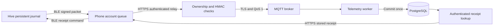

# Honey Chain: phone gateway and offline queue

Updated 21 October 2026. This extends [the authenticated storage receipt protocol](12-OFFLINE-DELIVERY-RECEIPTS.md). Phone gateway source, persistent-queue logic, BLE transport, authenticated MQTT relay and receipt lookup are implemented. The subsequent [firmware checkpoint](14-HIVE-FIRMWARE-AND-BENCH-PLAN.md) adds the reference ESP32 source and host tests. Physical firmware, actual browser/phone acceptance and power-loss trials remain open. Fieldwork has not started.

## Implemented path

The hive-monitoring page includes a phone gateway for the signed-in account's active enrolled devices. Collection uses Web Bluetooth. It keeps the original signed packet in IndexedDB before requesting the next journal entry. When internet is available, it relays saved packets to an authenticated server endpoint. The server checks the current account, hive ownership and device signature before publishing to MQTT.



Broker acceptance and database storage are separate states. The relay returns `BROKER_ACCEPTED`, never a storage receipt based only on MQTT PUBACK. The phone polls the read-only receipt endpoint. Only an identical committed row permits the server to issue a device-verifiable receipt. There is no fallback that inserts a reading directly when MQTT fails.

After a successful BLE acknowledgement write, the phone can remove its stored copy. The write response confirms transport delivery, not that firmware deleted anything. Firmware must verify the receipt MAC and full packet identity before deleting its journal entry. If a power failure prevents deletion, the hive can resend the same packet and obtain the same server receipt without creating another reading.

This flow stores telemetry off-chain. Existing actor-approved batch provenance and consumer QR verification remain separate. A storage receipt is not a blockchain transaction receipt, evidence of honey purity, or proof that a physical sensor was calibrated.

## Account and data boundaries

- Both phone endpoints require an active beekeeper/admin session, the expected request origin and an `X-Gateway-Account` header matching the session account. The header prevents an old tab from silently syncing under an account newly signed in elsewhere in the browser. It is not an authentication credential.
- A scoped hive lookup precedes credential inspection. A caller cannot relay or inspect another owner's device. Device ID, UUID epoch, sequence, signature and exact packet bytes remain bound together. Inactive credentials, old epochs and conflicting sequence content fail closed.
- Receipt lookup never inserts readings or publishes messages. Identical stored retries remain recoverable after the seven-day intake window. An old uncommitted reading is rejected rather than assigned a fresh timestamp.
- The queue keys include account, device, epoch and sequence. Concurrent tabs store one copy of identical content. Conflicting content does not overwrite it. The 5,000-packet capacity applies across all accounts in this browser, and writes commit before collection proceeds.
- IndexedDB transactions request strict durability where supported. Browser storage can still be unavailable, evicted or removed by the user. Firmware's persistent journal remains necessary. No device secret or MQTT private key reaches the phone queue.
- Account scoping controls the application display and requests. It does not encrypt local storage against other scripts from the same origin or the operating-system user. Pending copies are not silently erased on sign-out. The account can explicitly discard its own phone copy with an explanation of the consequence.
- BLE commands serialize into 20-byte writes with a 15-second deadline. Incoming frames and pending processing work are bounded. A storage failure, malformed/flooding device, GATT timeout or network error retains data and surfaces an error.

## Browser behavior and limits

Web Bluetooth requires a secure context and a user-triggered permission request, and support remains limited across browsers. The page checks feature availability and leaves sync of existing records available when Bluetooth is unsupported. Collection needs the page open. There is no service-worker/background Bluetooth collector or promise that an authenticated page can reopen while offline. See [MDN's Web Bluetooth reference](https://developer.mozilla.org/en-US/docs/Web/API/Web_Bluetooth_API).

The queue persists across database connection close/reopen in the application logic. The automated queue tests use the [fake-indexeddb implementation](https://github.com/dumbmatter/fakeIndexedDB), which retains state in memory for testing. They do not prove disk persistence, browser eviction behavior or physical phone battery endurance. Browser UI observation remains blocked by automatic approval review's usage limit. No alternate browser or CLI page-inspection route has been used.

## BLE firmware contract

Advertise this service UUID:

```text
7f6a1000-8e54-4d80-b8e4-9b732f6c4a01
```

Provide these characteristics:

- Notify telemetry: `7f6a1001-8e54-4d80-b8e4-9b732f6c4a01`
- Write-with-response commands: `7f6a1002-8e54-4d80-b8e4-9b732f6c4a01`

Every frame is one compact ASCII JSON object followed by a newline byte. The phone reassembles fragmented notifications. A telemetry frame is the existing signed envelope `{ "payload": "BASE64", "signature": "LOWERCASE_HEX_HMAC" }`. Its decoded packet is at most 4,096 bytes. The outer frame/notification limit is 8,192 bytes. Do not send pretty-printed multiline outer frames.

Commands are:

```json
{"command":"rewind"}
{"command":"next"}
{"command":"ack","receipt":{"payload":"BASE64","signature":"LOWERCASE_HEX_HMAC"}}
```

`rewind` resets a connection-local cursor and sends the first pending journal entry. `next` advances that cursor and sends the next entry. Neither deletes stored data. Track cursor identity by sequence/epoch rather than a mutable array index, because an acknowledgement may remove an earlier entry while collection continues. When caught up, send `{"event":"idle"}`; the phone polls for the next entry after 15 seconds.

`ack` must decode and authenticate the stored-receipt protocol in document 12, match device/epoch/sequence/exact-byte hash, and persist the deletion safely. It must never accept a bare sequence, arbitrary phone “uploaded” flag or broker PUBACK as permission to delete. A duplicate valid acknowledgement should be harmless. Provision keys through an operator-controlled local channel and keep a new epoch for key rotation.

Firmware implementation, sensor drivers/calibration, persistent sequence allocation, flash journal crash recovery and physical BLE pairing still require completion and testing. The TypeScript transport fixture and simulated device in integration tests do not substitute for that work.

## Optional cluster configuration

The base stack remains usable without a configured phone broker. Configure the existing IoT services and add `infrastructure/cluster/gateway.override.yml` to give the web service access to the MQTT network and its own client certificate:

```powershell
podman-compose --env-file PATH_TO_PRIVATE_STACK_ENV -f infrastructure/cluster/compose.yml -f infrastructure/cluster/gateway.override.yml --profile iot up -d
```

Supply `mqtt_gateway.crt` and `mqtt_gateway.key` in the cluster's private secret directory. Issue the gateway certificate with CN `honeychain-gateway`. Its broker ACL permits publishing to this cluster's device telemetry topics. Use a different certificate from the ingestion bridge, whose CN `honeychain-bridge` remains read-only. The web relay must verify account ownership and HMAC before using its broader broker permission.

For non-Compose deployment, set `IOT_GATEWAY_MQTT_URL`, `IOT_GATEWAY_MQTT_CA`, `IOT_GATEWAY_MQTT_CERT` and `IOT_GATEWAY_MQTT_KEY` on the server. The publisher requires `mqtts:`, verifies the server certificate, refuses URL credentials and uses a bounded MQTT v5 QoS-1 publish. Missing configuration produces an unavailable response and keeps the phone's packet.

Do not restart an ephemeral QA EVM and treat old bound databases/receipt hashes as the same chain. The integration test in this checkpoint uses the dedicated native PostgreSQL and the owned TLS broker directly, without restarting the old cluster EVM or rebinding preserved cluster databases.

## Executed evidence and remaining gates

The full unit suite passed **132 tests**, including 29 gateway tests covering API authorization, TLS configuration, framing, serialized BLE writes/timeouts, notification flood bounds, account-isolated queues, capacity races, commit sequencing, retries and cancellation. **Six gateway integration tests** passed with a real Mosquitto TLS broker and PostgreSQL, including the no-consumer/pending case, simulated hive receipt authentication and rejection of publishing with the read-only bridge certificate. The **six existing PostgreSQL/MQTT integration tests** also passed after the schema/authentication refactor. These refreshed suites total **144 tests**. The unchanged 32 contract and 10 PostgreSQL/EVM results from document 11 are a separate preceding checkpoint.

TypeScript, worker compilation and the final Linux production web build passed. Lint reported zero errors and 49 warnings across 171 files. The final web image includes the bounded BLE receive queue. The current production dependency audit reports zero known advisories. The development/build-tool audit still reports 59 advisories, as documented in the earlier dependency checkpoint; installing the development-only IndexedDB emulator did not resolve them.

The packaged Next.js web image and latest telemetry worker then passed HTTPS backend acceptance using the optional gateway Compose override: real password login, anonymous/stale-account rejection, TLS MQTT publication, PostgreSQL receipt lookup, simulated hive MAC verification and idempotent retry. The broker and database were real local services. The phone queue and hive were software fixtures. Both the preserved QA EVM and chain writer were inspected and remained stopped; no old database was rebound to a restarted chain. See `docs/qa/phone-container-acceptance.json`.

See `docs/qa/phone-gateway-verification.json` for the final unit/compiler/lint/build results. The native integration suite uses a trusted test session provider. The separate packaged-backend check uses an actual HTTP login cookie. Neither inspects browser UI. Real browser/device behavior and firmware still need their own acceptance evidence before a field release. All owned QA services, native integration PostgreSQL and the Podman machine were stopped afterward; data, keys, images and logs remain preserved. No application was submitted or publicly deployed.
